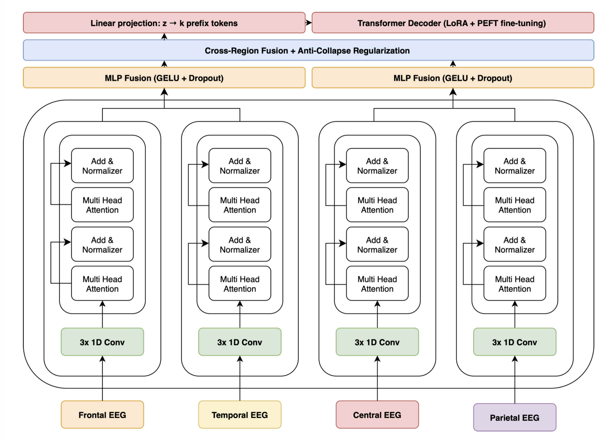
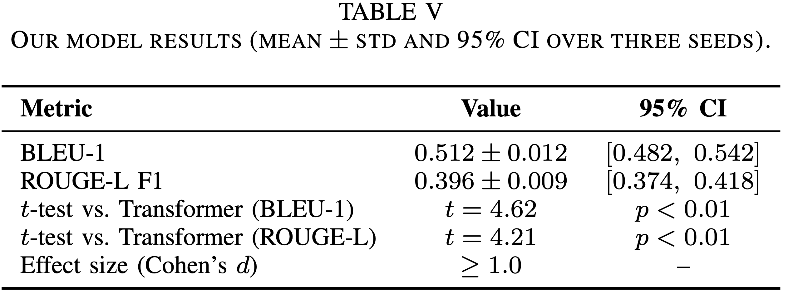
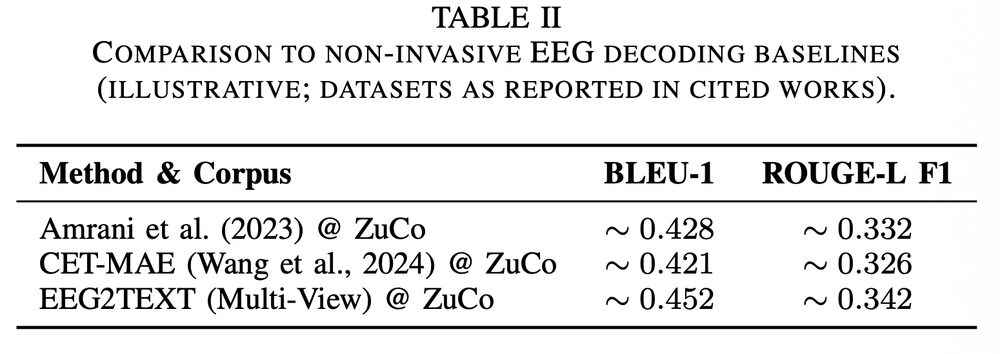

## Summary

This repository contains the code accompanying the paper [*A Novel Machine Learning Model for Non-Invasive EEG-Based Inner-Speech Translation in ALS*](https://ieeexplore.ieee.org/document/11435085).

## Dataset

The EEG model is trained on the **Chisco dataset**, which contains **30,000 sentences across 5 patients**. This is a pre-existing dataset that is separate from the sEMG data collection pipeline.

> Zhang, Z., Ding, X., Bao, Y. et al. Chisco: An EEG-based BCI dataset for decoding of imagined speech. Sci Data 11, 1265 (2024). https://doi.org/10.1038/s41597-024-04114-1

### Model Architecture

The EEG-to-text generation architecture employs a region-aware encoding strategy that processes cortical regions independently before fusion:

<h1 align="center">
  
</h1>

**Fig. 1.** Overview of the proposed EEG-to-text generation architecture. Each of the cortical regions (frontal, temporal, central, and parietal) is processed using a dedicated encoder composed of three 1D convolutional sublayers followed by multi-head attention and normalization stacked sublayers. The produced embeddings are input to region-specific MLP fusion sublayers activated using GELU and dropout. A cross-region fusion module with anti-collapse regularization integrates distributed cortical representations into a unified latent embedding, which is projected linearly to k learned prefix tokens. These prefix tokens precondition a LoRA and PEFT-trained transformer decoder for EEG-conditioned text generation.

**Key Components:**

1. **Region-Specific Encoders**: 
   - Each cortical region (frontal, temporal, central, parietal) has a dedicated encoder
   - Three 1D convolutional sublayers extract temporal features
   - Multi-head attention and normalization layers capture region-specific patterns

2. **Region-Specific MLP Fusion**:
   - GELU activation and dropout for regularization
   - Combines features within each cortical region

3. **Cross-Region Fusion Module**:
   - Integrates distributed cortical representations
   - Anti-collapse regularization prevents mode collapse
   - Produces unified latent embedding

4. **Prefix Projection**:
   - Linear projection to k learned prefix tokens
   - Conditions the transformer decoder on EEG features

5. **LoRA-PEFT Transformer Decoder**:
   - DeepSeek-R1-Distill-Qwen-1.5B as the base model
   - LoRA (Low-Rank Adaptation) and PEFT (Parameter-Efficient Fine-Tuning) for efficient training
   - Generates text conditioned on the EEG prefix tokens

> **Detailed Explanation**: For comprehensive model architecture details, training methodology, and experimental results, see [`Steiner (2026)`](https://ieeexplore.ieee.org/document/11435085).

## Results

<h1 align="center">
  <div style="display: flex; justify-content: center; align-items: center; gap: 10px; flex-direction: column;">
    
    
  </div>
</h1>

The results demonstrate the effectiveness of the region-aware architecture and cross-region fusion approach for EEG-to-text generation. The benchmark comparison shows performance against existing methods on the ZuCo dataset.


## Quickstart

This section is intentionally high‑level; see the code in each subfolder for experiment‑specific details.

### 1. Clone and Base Dependencies

```bash
git clone https://github.com/alexsteiner/eeg-inner-speech-translation.git
cd eeg-inner-speech-translation
```

### 2. Repository Structure

- **Configuration:** `config/training_config.py`  
  - Points to EEG data from the Chisco dataset (`CONFIG['data_dir']`, montage file, save directory).  
  - Sets model hyperparameters (e.g. `hidden_dim`, `decoder_prefix_len`, LoRA settings, diversity penalties).
- **Training script:** `scripts/train.py`
  - Builds an `EEGDataset` from `src/data/dataset.py` and electrode regions from `src/data/utils.py`.
  - Loads preprocessed Chisco dataset files (30,000 sentences, 5 patients).
  - Splits into train/validation and uses `DataLoader` with configurable workers.
  - Creates `EEGModel` with region‑aware encoders and DeepSeek LLM.
  - Uses separate optimizers and learning rates for:
    - encoder, LLM, projection, and LoRA parameters (see `get_optimizer_groups` in config).
  - Logs training and validation losses, saves `best_model.pt` and `last_model.pt` to a timestamped run directory.
  - Periodically calls `generate_samples` to decode qualitative examples from EEG and log target vs prediction.

- **Python:** create a virtualenv and install at least the requirements: ```pip install -r requirements.txt ```

### 3. Train Model

```bash
cd eeg-inner-speech-translation
python scripts/train.py
```

### Acknowledgments

A special thanks to **Dr. Melissa Zavaglia** for her guidance and support throughout the research process.